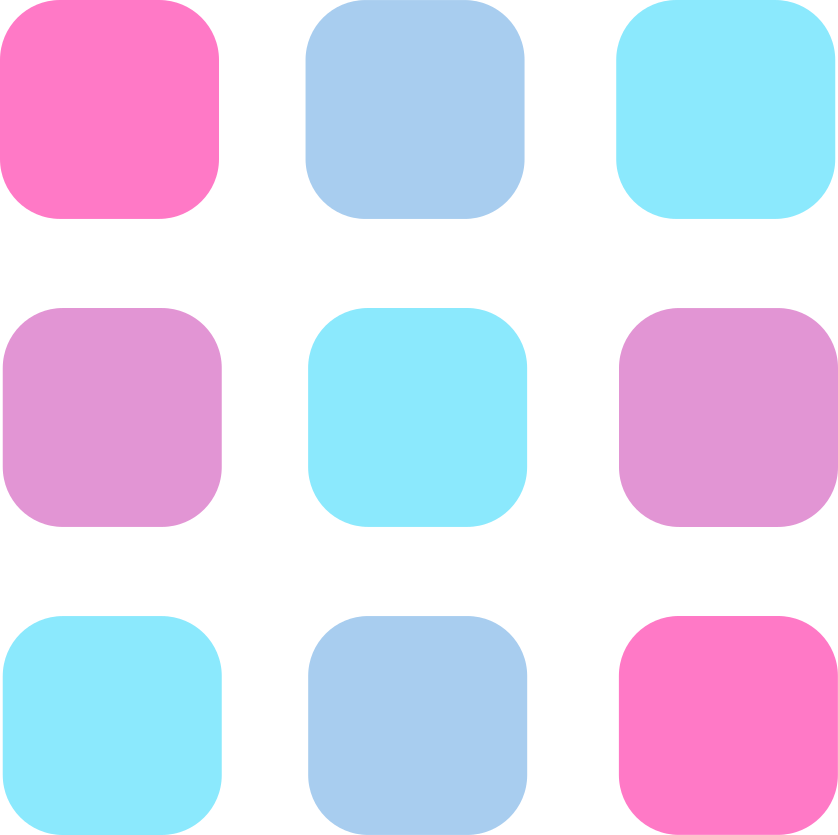
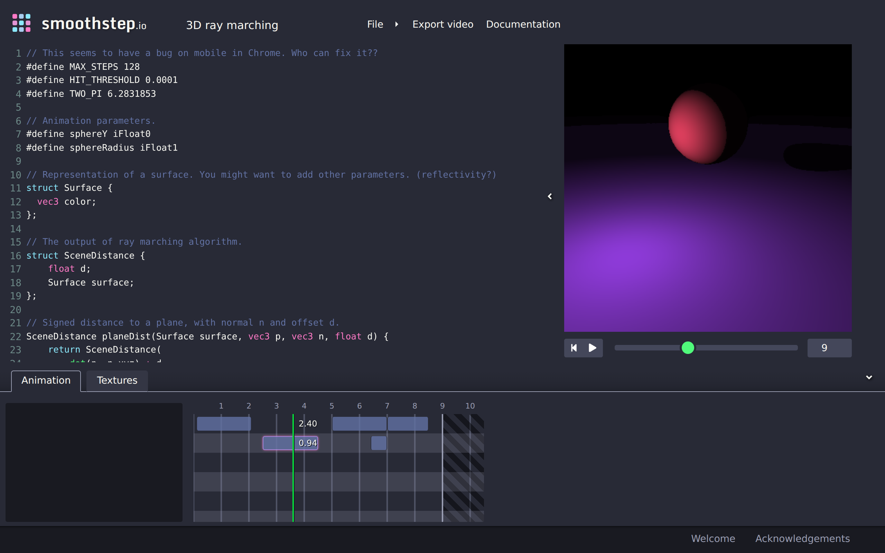

<h1 align="center">
  <br>
  smoothstep
</h1>

<p align="center">
  Make animations in the WebGL shader language, right in your browser.<br>
  <b><a href="https://smoothstep.io">Open smoothstep.io</a></b> ·
  <a href="docs/tutorial/README.md">Tutorial</a> ·
  <a href="docs/">Documentation</a>
</p>

<p align="center">
  <a href="https://smoothstep.io"></a>
</p>

smoothstep is a toolkit for making animations in the WebGL shader language. You write a
GLSL fragment shader, animate its inputs on a timeline, give it image textures, and export
the result as video. It all runs in your browser, with no server or sign-in.

You can use it at **[smoothstep.io](https://smoothstep.io)**, or run your own copy. The
[documentation](docs/) has a tutorial, examples and the full list of shader inputs.

<p align="center">
  
  <br>
  <sub>Four of the built-in examples: a Julia set fractal, a ray-marched sphere, a photo
  texture warped with sine waves, and a cellular automaton that reads its previous frame.</sub>
</p>

The editor highlights GLSL, shows compile errors on the line they occur, and gives you
inline pickers for colours, numbers and vectors. The timeline drives 16 animated variables,
`iFloat0` to `iFloat15`, each a sequence of step, linear or smoothstep transitions. You get 8
texture slots, `iTexture0` to `iTexture7`, which take built-in photos, noise, tiling textures
and font sheets, or your own images up to 4096px. smoothstep exports WebM, MP4, animated
GIFs and PNG frames, all made in your browser.

smoothstep keeps your animations and uploads in your browser's storage. You can download one
animation, or all of them as a zip, to back them up, move them to another computer or share
them, and open them again with File → Open → "Open file…".

From 2021 to 2026, smoothstep.io was a hosted site with accounts. If you saved your
animations from it with "Download my data", open that zip with "Open file…".

## Running it

You need Node 20.

```bash
npm install --legacy-peer-deps   # old peer ranges need the flag
npm start                        # dev server on http://localhost:3000
npm run build                    # production build in build/
npm run lint
```

`npm run build` makes a plain static site in `build/`. You can put it on any static host,
such as GitHub Pages or Netlify, at any path. To try it locally, run
`python3 tools/serve.py 8000 build`. It works offline, apart from MP4 export, which downloads
the ffmpeg core (about 31 MB) from unpkg the first time. Saved animations open at
`#anim/<id>`, and the bundled examples at `#example/<id>`.

The scripts set `NODE_OPTIONS=--openssl-legacy-provider`, because webpack 4 uses a hash that
Node 17 and later disable. `.env` turns off source maps for production builds.

## How it's built

smoothstep uses React 17 with create-react-app 4 (`react-scripts` 4.0.1), class components,
react-bootstrap 1 with Bootstrap 4.5, and Sass.

`src/App.js` holds the app's state (code, timeline, textures and export) and lays out the
navbar, code editor, canvas and player, and the Animation and Textures tabs. It also handles
saving, loading and export. `src/localStore.js` keeps animations and uploaded images in
IndexedDB, and `src/archive.js` downloads and opens files, in the formats described in
[FILE_FORMATS.md](FILE_FORMATS.md).

The components in `src/components/` are:

- `Canvas.jsx`, which compiles and renders the shader with WebGL 2 and reports compile
  errors by line
- `CodeEditor.jsx`, the CodeMirror 5 editor, with its GLSL mode in `src/shaderMode.js` and
  its inline pickers in `src/glslEditor/` (adapted from
  [glslEditor](https://github.com/patriciogonzalezvivo/glslEditor))
- `AnimationControls.jsx`, the timeline, and `PlayerControls.jsx`, the play and seek bar
- `Textures.jsx` and `TexturePicker.jsx`, the texture slots, built-in textures and uploads
- `ExportSettings.jsx`, the export dialog
- `DocumentBrowser.jsx`, the File → Open dialog, which lists, opens, downloads and deletes
  saved animations, and opens files
- `Splash.jsx`, the welcome dialog with the examples, and `Acknowledgements.jsx`

Everything in `public/` is copied into the build as it is. That includes the built-in
textures in `images/textures/` (credited in [CREDITS.md](public/images/textures/CREDITS.md)),
the example animations in `examples/`, `CCapture.js` and `gif.worker.js` for recording and
GIF encoding, and ffmpeg.wasm's browser files in `ffmpeg/`.

`tools/` has the scripts that generate data, and the tests. `buildTextures.py` makes
`src/textures.json` and the texture thumbnails, `buildFonts.py` draws the font sheets, and
`buildFunctions.py` makes `src/glslFunctions.json`, the GLSL built-ins the editor's hints
show. `serve.py` serves a build, and `test_static.py` and `test_export.py` are Playwright
end-to-end tests, with their usage at the top of each file.

### MP4 export

smoothstep converts CCapture's WebM recording to MP4 with ffmpeg.wasm 0.12. It uses the
single-threaded core, which doesn't need `SharedArrayBuffer` or COOP/COEP headers. Webpack 4
can't parse the `@ffmpeg/ffmpeg` package, so it's a devDependency, and
`npm run vendor-ffmpeg` copies its browser files into `public/ffmpeg/`. Rerun that after
upgrading it. Your server must send `ffmpeg/*.js` as JavaScript, because the worker is a
module worker.

## Licence

The code is under the [MIT licence](LICENSE). The built-in textures and fonts keep their own
licences, listed in [CREDITS.md](public/images/textures/CREDITS.md).

smoothstep is made by [Matt Henderson](https://twitter.com/matthen2).
