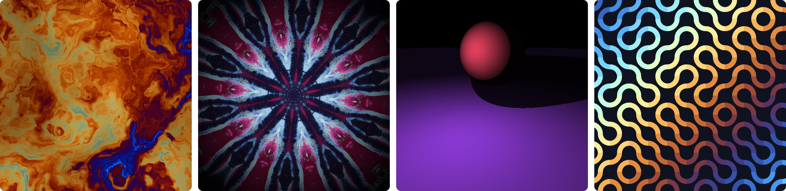

<h1 align="center">
  <br>
  smoothstep.io
</h1>

<p align="center">
  Make animations with WebGL shaders and a little JavaScript, right in your browser.<br>
  <b><a href="https://smoothstep.io">Open smoothstep.io</a></b> ·
  <a href="https://smoothstep.io/#tutorial">Tutorial</a> ·
  <a href="https://smoothstep.io/docs/">Documentation</a>
</p>

<p align="center">
  <a href="https://smoothstep.io"></a>
</p>

smoothstep.io is a toolkit for making animations in the WebGL shader language. You write a
GLSL fragment shader, animate its inputs on a timeline, give it image textures, and export
the result as video. For text, shapes and physics, a Canvas2D layer adds JavaScript that draws on a
2D canvas over the image. It all runs in your browser, with no server or sign-in.

I started smoothstep.io in 2021 as a closed-source hosted site, with accounts that kept your
animations on a server and let you share them with links. In November 2026 I rewrote it to run entirely in the browser, with no
server or accounts, and released it here as open source under the MIT licence. If you saved your
animations from the old site with "Download my data", add that zip with File → Import.

You can use it at **[smoothstep.io](https://smoothstep.io)**, or run your own copy. To learn, start
the [tutorial](https://smoothstep.io/#tutorial): it runs in the app, beside the editor, and each step
notices when you've done it. The [documentation](https://smoothstep.io/docs/) covers the shader
inputs, the Canvas2D layer, the keyboard shortcuts and the examples. The app shows it in a Docs tab
beside your code, under Help → Documentation. It's written in Markdown in [docs/](docs/), which reads
fine here on GitHub.

<p align="center">
  
  <br>
  <sub>Four of the built-in examples: domain-warped noise, a kaleidoscope of a painting, a
  ray-marched scene, and Truchet tiles.</sub>
</p>

The editor highlights GLSL, shows compile errors on the line they occur, and gives you
inline pickers for colours, numbers and vectors. The timeline drives 16 animated variables,
`iFloat0` to `iFloat15`, each a sequence of transitions that step, move steadily, ease in or out,
overshoot and settle, or grow exponentially for zooms. The Sliders tab has a slider for each one your code uses, to set it or try out
values while you watch. You get 8
texture slots, `iTexture0` to `iTexture7`, which take built-in photos, noise, tiling textures
and font sheets, or your own images up to 4096px. Up to 4 buffers, `iBuffer0` to `iBuffer3`,
are extra shaders that draw before the image each frame and hold any numbers, so you can run
simulations across frames. A Canvas2D layer is JavaScript that draws on a 2D canvas each step, with
drawing helpers, fonts, and built-in physics, noise and triangulation libraries; its drawing goes
over the image, and every shader can read it as `iCanvas2D` ([docs/canvas2d.md](docs/canvas2d.md)).
smoothstep.io exports WebM, MP4, animated GIFs and PNG frames, all made
in your browser.

smoothstep.io keeps your animations and the images you add in your browser's storage. You can download one
animation, or all of them as a zip, to back them up or move them to another computer, and add
them again with File → Import.

Sharing needs no server. Share gives you a link with the whole animation compressed into it,
code to show it playing on any website, and a player file that works offline. smoothstep.io also opens
animation files from GitHub gists and other websites ([docs/sharing.md](docs/sharing.md)).

## Running it

You need Node 24 (the version is in `.nvmrc`).

```bash
npm ci
npm run dev        # dev server on http://localhost:5173
npm run build      # type-checks, then builds the static site in dist/
npm run preview    # serves dist/
npm run lint
npm test           # unit tests
npm run test:e2e   # end-to-end tests in Chromium, against the build
```

`npm run build` makes a plain static site in `dist/`. You can put it on any static host,
such as GitHub Pages or Netlify, at any path. It needs no server code or network access to run,
including video export.

The build includes a service worker, `sw.js`, which lets the app load with no network after the first
visit and installs new versions in the background. It only handles the directory it's served from, so
keep `sw.js` beside `index.html`, and serve it without long cache headers (`Cache-Control: no-cache`
is right), so browsers notice new versions. Browsers only run service workers over HTTPS or on
localhost. `npm run dev` doesn't register it, so development always shows your latest changes.
The build also turns the Markdown in `docs/` into a small docs site in `dist/docs/`, served at
`docs/` beside the app (`npm run dev` serves it too), and into the pages the editor's Docs tab shows.
Saved animations open at `#anim/<id>`, the bundled examples at `#example/<id>`, and the tutorial at
`#tutorial` (or `#tutorial/<lesson>`), in a new animation. Shared animations open at
`#share/<data>`, `#gist/<id>` and `#url/<address>`, and `embed.html` takes the same addresses to
play an animation on its own.

## How it's built

smoothstep.io is a React 19 app in TypeScript, built with Vite. It uses Mantine for its interface,
Sass for the app's own styles, CodeMirror 6 for the code editor, and WebGL 2 for rendering.

- `src/app/` has `App.tsx`, which holds the open animation and lays out the page, the URL
  handling, the tour, the one-time tips (`tips.ts`), and the crash screen. If the app ever hits
  an error, the crash screen lets you download the animation you were editing and everything
  you've saved.
- `src/lib/` has the animation format and its checks (`document.ts`), the IndexedDB store
  for animations and uploaded images (`localStore.ts`), and file downloads and imports
  (`archive.ts`), in the formats described in [FILE_FORMATS.md](FILE_FORMATS.md). The
  addresses the app opens are in `routes.ts`, and `share.ts` makes share links and loads
  animations from links, gists and other websites.
- `src/player/` is the bare player, without React, behind `embed.html` and the player files that
  Share downloads.
- `src/render/` compiles and draws the buffers and the image, and maps compile errors back to
  lines of your code.
- `src/layer/` runs the Canvas2D layer: a worker inside a sandboxed iframe, with the drawing helpers
  (`helpers.ts`), the built-in libraries (`libraries.ts`) and fonts (`fonts.ts`).
- `src/editor/` is the code editor, with GLSL highlighting, hints, the inline pickers and the
  tabs for the image, buffers and shared code.
  The pickers are adapted from [glslEditor](https://github.com/patriciogonzalezvivo/glslEditor).
- `src/timeline/` is the timeline and the play and seek bar.
- `src/dialogs/` has the welcome, Open, texture, export, share and other dialogs.
- `src/tutorial/` is the tutorial: its lessons and their checks (`lessons.tsx`), and the Learn panel
  that shows them beside the editor.
- `src/docs/` builds the docs: `render.ts` turns `docs/*.md` into pages with
  [marked](https://marked.js.org), colouring code as the editor does, and `plugin.ts` makes the docs
  site and the pages for `src/reference/`, which shows them in the editor's Docs tab.
  `reference.ts` writes the Reference page from the lists the editor's popups use: the shader inputs
  (`src/lib/shaderInputs.ts`), the Canvas2D layer's names (`src/editor/canvas2dReference.json`), its
  fonts and its libraries.
- `src/pwa/` makes the app work offline and installable: `worker.ts` is the service worker,
  `plugin.ts` builds it with the list of files to keep (`cachePlan.ts`), and `updates.ts` registers it
  and offers to reload into a new version.
- `src/export/` renders an animation frame by frame and encodes it in the browser. WebM and
  MP4 use the browser's WebCodecs encoder through [Mediabunny](https://mediabunny.dev), GIF
  uses [gifenc](https://github.com/mattdesl/gifenc), and PNG frames download as a zip.

Everything in `public/` is copied into the build as it is. That includes the built-in
textures in `images/textures/` (credited in [CREDITS.md](public/images/textures/CREDITS.md))
and the example animations in `examples/`: each has its `.json`, a `.png` thumbnail and a short
`.mp4` preview for the example gallery. The list of examples, with their descriptions, is in
`src/lib/config.ts`.

`tools/` has the scripts that generate data. `buildTextures.py` makes the texture list and
thumbnails, `buildFonts.py` draws the font sheets, and `buildFunctions.py` makes the list of
GLSL built-ins the editor's hints show. `buildLayerAssets.mjs` bundles the Canvas2D layer's libraries
into `public/libs/` and copies its fonts into `public/fonts/`. `makeExamplePreviews.mjs` renders the examples' previews
and thumbnails with the app's own exporter. The end-to-end tests are in `e2e/`. They block every
request that isn't to your own machine, so they also check that the app works offline.

## Licence

The code is under the [MIT licence](LICENSE). The built-in textures and fonts, and the libraries
the Canvas2D layer can import (planck.js, matter.js, simplex-noise and d3-delaunay), keep their own
licences, listed in [CREDITS.md](public/images/textures/CREDITS.md).

smoothstep.io is made by [Matt Henderson](https://www.matthen.com/).
