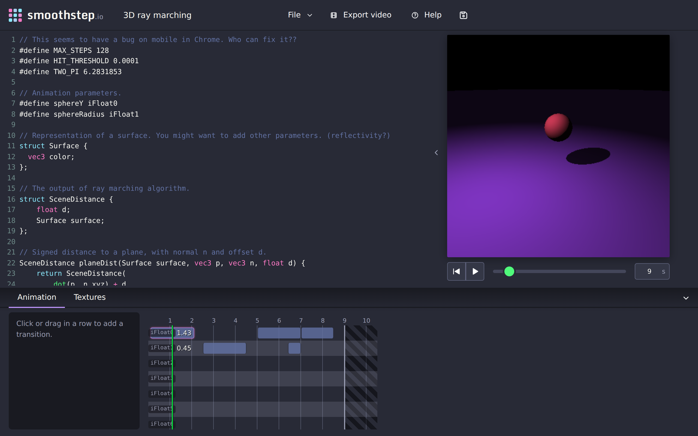

# smoothstep.io documentation

You make animations in smoothstep.io by writing a fragment shader in the WebGL shader language
(GLSL). A timeline lets you animate the shader's inputs visually, and you can give it the
built-in textures or add your own images. When it's ready, you export it as video at any
frame rate and resolution. It all runs in your browser at [smoothstep.io](https://smoothstep.io).

To draw text, shapes or physics simulations, add a [Canvas2D layer](canvas2d.md): JavaScript that draws
on a 2D canvas over the image.

[Start the tutorial](https://smoothstep.io/app/#tutorial), which runs in the app beside the editor, or
[open smoothstep.io](https://smoothstep.io).

These pages are also at [smoothstep.io/app/docs](https://smoothstep.io/app/docs/), and in the app
under Help → Documentation, as a tab beside your code.

## Contents

- [Tutorial](tutorial/README.md)\
  Ten short lessons you follow in the app, from your first shader to sharing it
  1. [Colour from position](https://smoothstep.io/app/#tutorial/1)
  2. [Moving with time](https://smoothstep.io/app/#tutorial/2)
  3. [Shapes](https://smoothstep.io/app/#tutorial/3)
  4. [The timeline](https://smoothstep.io/app/#tutorial/4)
  5. [Patterns](https://smoothstep.io/app/#tutorial/5)
  6. [Textures](https://smoothstep.io/app/#tutorial/6)
  7. [Memory with iPrevFrame](https://smoothstep.io/app/#tutorial/7)
  8. [Buffers](https://smoothstep.io/app/#tutorial/8)
  9. [Draw with JavaScript](https://smoothstep.io/app/#tutorial/9)
  10. [Share it](https://smoothstep.io/app/#tutorial/10)
- [Examples](examples.md)\
  Animations to open, play and change
- [Sharing animations](sharing.md)\
  Links, gists, and putting animations on your own website
- [Keyboard shortcuts](keyboard-shortcuts.md)\
  For the code editor and playing the animation
- [Coding specification](coding-specification.md)\
  What your shaders can use: inputs, textures, buffers and shared code
- [The Canvas2D layer](canvas2d.md)\
  JavaScript that draws text, shapes and simulations over the image
- [Reference](https://smoothstep.io/app/docs/reference.html)\
  Every input, helper, font and library, in tables
- [Acknowledgements](acknowledgements.md)\
  The projects, textures and fonts smoothstep.io uses

## Help in the app

Help → Documentation opens these pages in a Docs tab next to your code. Code examples have an
Insert button, which puts the code at the cursor in the tab you were editing. Links in the editor's
popups and errors open the Docs tab at the right section.

New animations start with the Docs tab. Close it with its × and they start without it.

The Help menu also has the tutorial, the tour and the welcome dialog. The welcome dialog
shows a different tip each visit. While you work, smoothstep.io shows a short tip the first time some
things happen, such as your first compile error or your first save. Each tip shows once, and "Don't
show tips" turns them off.

## Saving your work

smoothstep.io saves your animations and the images you add in your browser. File → Save keeps the
animation you have open, and File → Open lists the animations saved there. Saving an example, or an
animation someone shared with you, keeps a copy as one of your own and leaves the original as it is.
Until you save it, a tag beside the title says it's an example or shared.

File → Export downloads the animation you have open as a `.smoothstep.json` file, and the Open
dialog's "Export all" downloads everything as a zip. File → Import adds the animations in either kind
of file to the ones in your browser, and opens the animation if there's only one. It also imports an
animation from a link.

Your browser is the only place your work is kept, so download anything you want to back up or move
to another computer.

## Working offline

After your first visit, smoothstep.io keeps a copy of itself in your browser, so it opens and works
with no internet connection: the editor, these docs, the Canvas2D layer, Render and the embedded
player. Built-in textures and examples are kept the first time you use them, so ones you haven't used
yet need a connection. Gists and links to other websites always do.

New versions download in the background. When one is ready, a notice says so, and its Reload button
switches to it. If the animation you have open has unsaved changes, it asks first.

Some browsers, such as Chrome and Edge on a computer, can install smoothstep.io as an app that opens in
a window of its own. When yours offers it, Help → Install as an app installs it, as does the install
button in the address bar. The app keeps the same saved animations as the website in that browser.
Installed in Chrome or Edge, it can also open `.smoothstep.json` files from your computer: choose
smoothstep.io from the file's "Open with" menu.

## Sharing

Share gives you a link with the whole animation in it, a QR code of that link, code to show the
animation playing on a website, and a player file. It also makes links that open an animation file
you've put online, such as in a GitHub gist, which keeps your own images with it. File → Import adds animations that
others have shared, including animation files in GitHub gists. [Sharing animations](sharing.md) has
the details.

## Acknowledgements

[Acknowledgements](acknowledgements.md) lists the open-source projects smoothstep.io is built on. The
built-in textures and fonts, and the libraries the Canvas2D layer can import, are credited, with their
licences, in [CREDITS.md](../public/images/textures/CREDITS.md).

## Feedback

Please get in touch with the developer, [Matt Henderson](https://www.matthen.com/), with any
feedback or questions.
