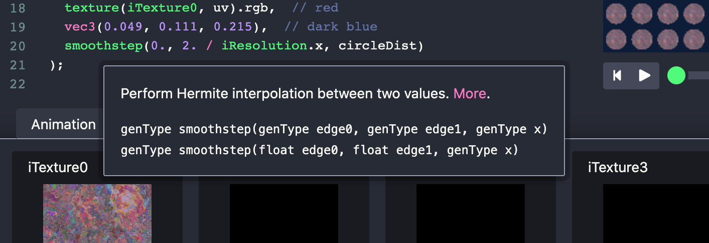

# Tutorial

This guide will teach you the basics of creating animations with smoothstep.

1. [Creating a simple shader](1-simple-shader.md)
2. [Drawing a circle](2-drawing-a-circle.md)
3. [Stateful animations](3-stateful-animations.md)
4. [Next steps](4-next-steps.md)

## Shaders

Animations in smoothstep are actually *fragment shaders*, written in the WebGL2 shader language (*GLSL*). A shader computes the color of every pixel of each frame in parallel, using the location of the pixel, and variables like `iTime` that encode the frame timing. Your computer may run the code on its GPU, making the animations run fast. (But you can always export your animations at any frame rate, even if they do not run in real time.)

As you learn to code in GLSL, you can click on functions like `smoothstep` and input variables like `iTime` within the editor to see their definitions:

## Shadertoy

smoothstep is partly modeled after [Shadertoy](https://www.shadertoy.com/), but with features specifically for building animations. This means that you can use a lot of the resources for learning [Shadertoy](https://www.shadertoy.com/). In fact, a lot of code from [Shadertoy](https://www.shadertoy.com/) will also run on smoothstep.

One excellent tutorial series is [TheArtofCode's Shadertoy tutorial](https://www.youtube.com/watch?v=u5HAYVHsasc&list=PLGmrMu-IwbguU_nY2egTFmlg691DN7uE5&ab_channel=TheArtofCode) on YouTube.

[Start the tutorial](1-simple-shader.md)
